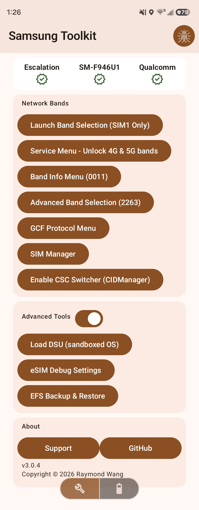
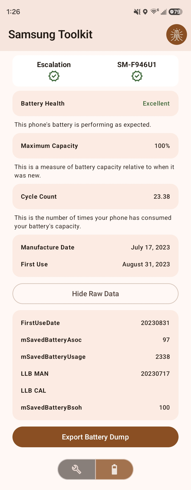
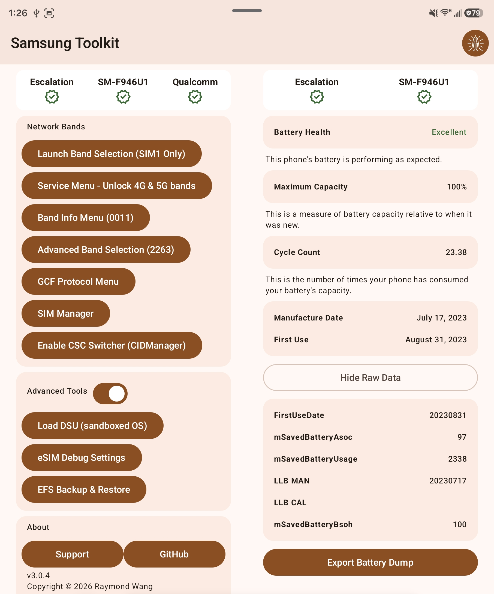
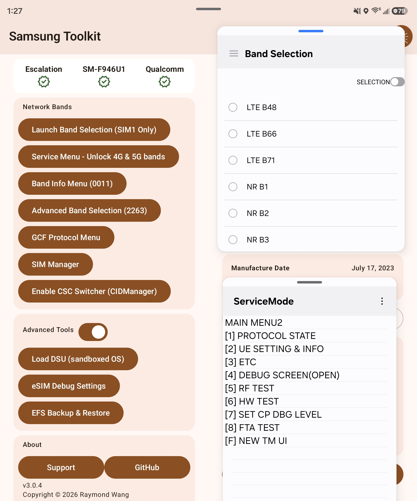

## Description

This app provides advanced tools to unlock your Samsung phone's full potential, without the need for either a PC or cable.

Including the ability to,

- Launch Band Selection (both Legacy and Advanced versions)

- Access the Service Menu to unlock 5G NR and 4G LTE bands on Qualcomm-powered Samsung devices

- View the device's battery health even outside the EU

- View connected bands and carrier aggregation

- Access the SIM Manager directly

- Disable/enable CID Manager (CSC Switching on SIM swaps)

- Load Dynamic System Update Mode (DSU, sandboxed OS)

- Access hidden EFS menu

and more!

Fully supports foldable devices!

## Prerequisites

- [Shizuku](https://github.com/rikkaapps/shizuku) must be fully set up and running. It is highly recommended to download the [latest version from GitHub](https://github.com/RikkaApps/Shizuku/releases/) as the Play Store release is outdated.

- Samsung phone running One UI 8 or newer. One UI 5, 6, and 7 devices **may** work with limited functionality.

- Qualcomm-powered phone is required for some features (e.g. fully unlocking bands, accessing the hidden EFS menu)

## Demo

### Video

### Images

## Notes

Tested and verified working on Fold5 (F946U1), S24 Ultra (S928U1), S25 FE (S731U1), Fold7 (F966U1).

### Community Tested

- Note 20 Ultra (N9860), partially working.

- S25 Ultra (S938N), fully working.
